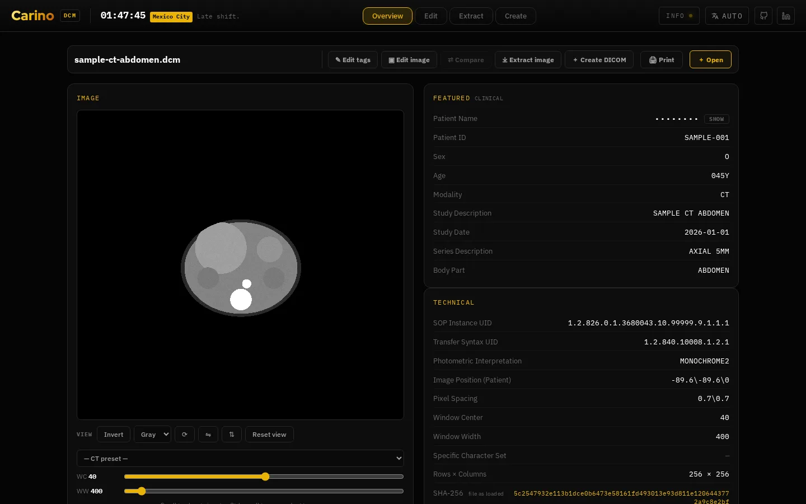
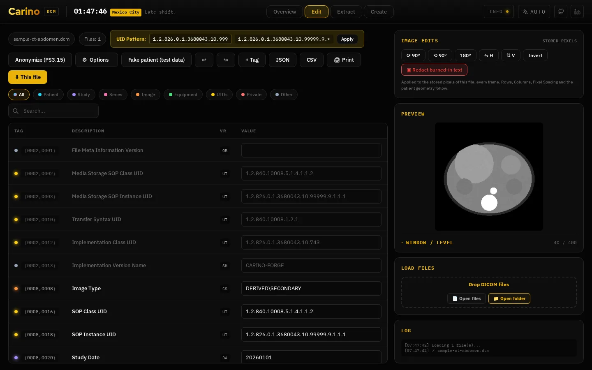
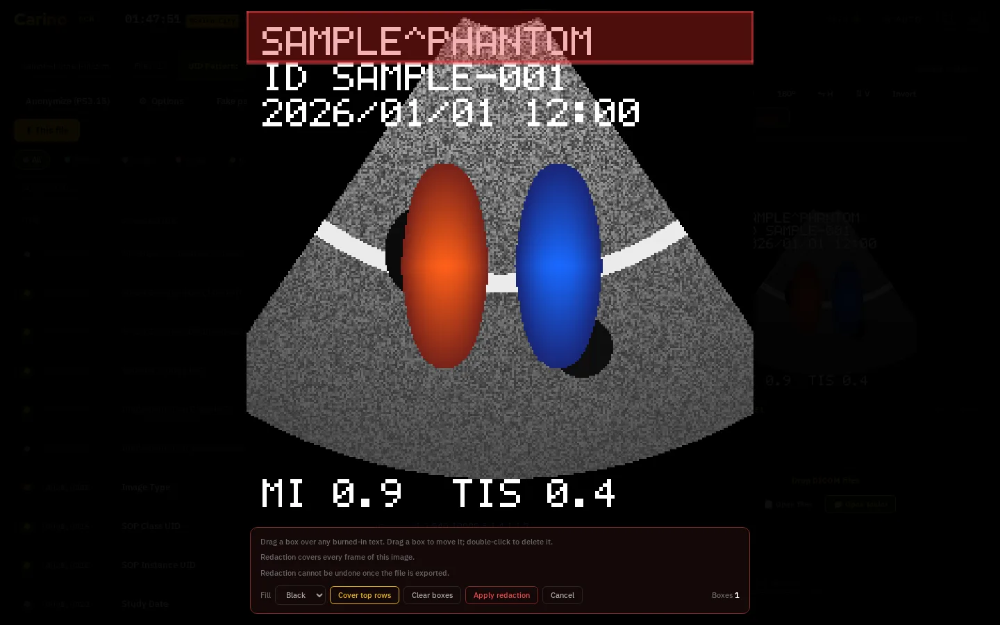
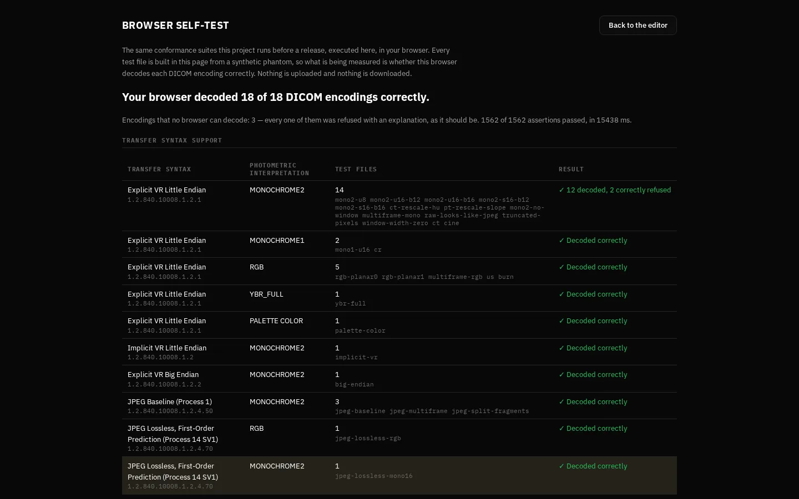

# Carino DICOM Editor

View, edit, create, compare, validate and **de-identify** DICOM files in the browser.
Nothing is uploaded and there is no server. **[dcm.carino.systems](https://dcm.carino.systems)**

It is a static page (`index.html`, `app.css`, plain scripts in `js/`) built on
[dcmjs](https://github.com/dcmjs-org/dcmjs), with no build step. The repository used to
be called `DICOM-editor`; GitHub redirects the old name.



## What it does

- **View**: drop a file or folder. Files are sorted by series and instance number. The
  wheel moves through the series, Ctrl/⌘+wheel zooms, and window/level stays the same as
  you scroll. Multi-frame files play as cine.
- **Edit tags**: every attribute in an editable table, with undo/redo and JSON/CSV
  export. The full PS3.6 dictionary is bundled, so every standard tag has a name.
- **Edit image**: rotate, flip, invert and redact the **stored pixels**, not just the view.
  Nothing is resampled. Rows/Columns, pixel spacing and patient geometry are updated to
  match, and the file is marked `DERIVED` with a new SOP Instance UID.
- **De-identify**: **Anonymize** applies the PS3.15 Basic Confidentiality Profile.
  **Fake patient** fills in made-up demographics for test data.
- **Swap patients**: with exactly two studies loaded, each study takes the other's patient
  (all of group 0010) and keeps its own images, dates, times and description. Accession
  Number moves only if you tick it. New UIDs are on by default, so a PACS that hides old
  studies instead of deleting them does not merge the re-upload back into them. A preview
  shows both sides first and warns when both already carry the same Patient ID.
- **Compare, Extract, Create**: diff two files, export frames as PNG/JPEG, or build a new
  DICOM file from scratch.
- **Compression**: the Overview and the Image edits card say how the pixels are encoded and
  whether that lost anything, judged from the codestream (JPEG-LS `NEAR`, the JPEG 2000 wavelet),
  the transfer syntax and `(0028,2110)`. They also warn when other viewers are likely to show the
  same pixels differently (signed values in compressed form, a JPEG 2000 sign that disagrees with
  Pixel Representation, no window), and when a file looks like a rendered or reduced copy (8-bit CT/MR,
  a Secondary Capture, smaller than the rest of its series). JPEG Lossless with a point transform is
  reported lossy; JPEG XL, JPIP (pixels on a server) and private vendor syntaxes are named. **Decompress** (one file
  or all) rewrites the pixels as Explicit VR Little Endian with the same SOP Instance UID: exact for
  a lossless source; a lossy source stays lossy and keeps `(0028,2110) = 01`. Compare decodes both
  files and says whether the pixels match even when the encodings differ, lists the compression
  facts that differ (syntax, lossless or lossy, ratio, stored size, the lossy-history tags, image
  size, Bits Stored, SOP Class, viewer warnings), and the Comparison report prints all of them in a Pixel data & compression section.

## Eye photos

Many fundus cameras and slit lamps in small clinics save only JPEG, and free converters turn
those into DICOM with no eye and the wrong modality. **Create → File type → Eye photo** writes
**Ophthalmic Photography 8 Bit Image Storage** (`1.2.840.10008.5.1.4.1.1.77.1.5.1`, Modality `OP`)
instead:

- **Every photo needs an eye.** Each thumbnail has a Right / Left / Both picker, filled in when
  the file name says OD, OS, OU, OI, OE, right, left, derecho or izquierdo. Nothing is written
  until every photo has one. It goes into Image Laterality `(0020,0062)`.
- **The camera's JPEG is kept without re-encoding** as JPEG Baseline, `YBR_FULL_422`, marked
  lossy with its compression ratio. What the camera adds around the picture is left out: EXIF
  and XMP (GPS, owner, serial number, preview), comments, and anything after the image's end
  marker. Only the JFIF header, ICC profile and Adobe colour marker stay, since they change how
  it decodes. A JPEG that cannot be filed that way (progressive, RGB-coded, or
  turned only by its EXIF tag, which DICOM viewers ignore) is stored decoded, still marked lossy.
  PNG is stored as uncompressed RGB.
- **The ophthalmic modules are filled in**: the camera type and the part of the eye as coded
  values (fundus camera, slit lamp or external camera), the capture time from EXIF when the
  photo has one, and the other mandatory attributes present, empty when unknown.
- **Fundus photos need the camera's field of view** (on the camera or in its manual, often 45°
  or 50°). The standard requires a pixel size for them, and this one is nominal: about 0.29 mm
  of retina per degree.
- **Burned-in text** is assumed (camera photos often print the name or date) unless you untick it.

The eye comes from you or from the file name. A guess from the picture itself (which side the
optic disc is on) is not offered, because it could not be tested on real photos.

### Opening Create from a worklist

A worklist (Carino DICOM) can open Create with an order already filled in, so the photos join
the ordered study. The keys are the ones Carino DICOM's orders use:

```
https://dcm.carino.systems/#create=eye&patient_name=DOE%5EJANE&patient_id=123
    &patient_birthdate=19800102&patient_sex=F&accession=A1&study_desc=Fundus%20photos
    &procedure_id=RP1&sps_id=SPS1&study_uid=1.2.3.4&referring=HOUSE%5EGREG
```

`#create` alone opens Create; `=eye` also picks Eye photo. Values are URL-encoded. The hash is
removed from the address bar as soon as it is read, but the browser has already recorded the
visit in its own History database, so a sender should carry patient details in a bridge order
rather than in a link. Over the [Carino Bridge](carino-bridge.js)
the same keys travel in a file named `*.carino-create.json`,
`{ "carinoCreate": 1, "kind": "eye", "patient_id": "123", … }`, optionally with the photos beside
it, and nothing reaches the URL. A value too long for its DICOM field, a malformed UID, date or
sex is dropped, not cut short. With `study_uid` every file joins that study; `procedure_id` and
`sps_id` go into the Request Attributes Sequence. Only the hash form is read: a query string
(`?create=…`) would put the patient's details in the server's access log.

A bridge order may also carry `"reply": "<token>"` (16 to 128 letters, digits, `_` or `-`).
Create then sends what it makes back to the page that sent the order instead of downloading
it, and the button says **⬆ Create and send back**. The files go to `window.opener`, posted only
to the origin the bridge delivered from, as
`{ "carinoCreate": "files", "reply": "<token>", "files": [{ "name", "type", "body" }] }` with each
body an `ArrayBuffer`. The sender answers `{ "carinoCreate": "stored", "reply": "<token>", "ok",
"message" }`. A refusal is shown and can be retried. If the sender's window is gone, the files
are downloaded. Carino DICOM uses this for **Add eye photos** on an order.

While an order is attached, the patient's name and ID cannot be edited. **Make a new study
instead** detaches it; **Anonymize** and **Randomize** detach it too, and clear the accession
number and referring physician.



## Trying it without a file

The empty page has five **samples** that are generated in the browser. None of them is a
real patient.

| Sample | What it tests |
| --- | --- |
| CT abdomen | signed 16-bit pixels, rescale, a window in Hounsfield units |
| Chest X-ray | `MONOCHROME1` inversion |
| Ultrasound | interleaved RGB |
| Cine loop | 16 frames at 30 fps |
| Burned-in text | patient details drawn into the pixels |

`#sample=<id>` opens a sample directly, and `#case=<id>` opens any case from the test
corpus. The [reference gallery](https://dcm.carino.systems/tests/gallery.html) uses
these links.

## De-identification

**Anonymize** follows **PS3.15 Annex E, Table E.1-1**. The rules for 656 attributes are
in [`deid-profile.js`](deid-profile.js). It also:

- cleans inside sequences, not only at the top level; a sequence it cannot see into
  (stored as unknown `UN` bytes) is removed rather than exported unread
- removes private tags, curve data and whole overlay planes
- remaps instance UIDs consistently across the loaded files (File Meta `(0002,0003)`
  included), and leaves standard `1.2.840.10008` UIDs and the UIDs that name a SOP
  Class, transfer syntax or coding scheme alone
- writes `(0012,0062)` Patient Identity Removed = `YES`, and adds its method to
  `(0012,0063)` and `(0012,0064)` without dropping earlier ones (a redaction's Clean
  Pixel Data stays recorded)
- sets Patient's Name to `ANONYMOUS`. Sex is emptied and Age removed, as the table says;
  only Retain patient characteristics keeps them
- refuses to run if `deid-profile.js` did not load, rather than claim a profile it did
  not apply. Anonymize ends the session's undo; exported names no longer carry the
  source folder or file name

**⚙ Options** adds five of the optional profiles: Retain UIDs, Retain device identity,
Retain institution identity, Retain patient characteristics and Retain full dates. Only
the attributes the standard marks **K** (keep) are kept. The other five profiles need
free-text or graphics cleaning, date shifting, or a list of known-safe private
attributes, which this tool does not do, so they are not offered.

**Burned-in text.** Tag edits cannot remove text drawn into the image. **▣ Redact
burned-in text** opens a full-screen view where you drag boxes over the text. Redaction
fills **every frame** with the darkest value for the photometric interpretation.
Compressed images are decompressed first. Afterwards Burned In Annotation is set to
`NO` and the Clean Pixel Data option is recorded.

**Find burned-in text** in that view reads every frame with OCR on your own machine. Nothing
is uploaded: the engine ([Tesseract.js](https://github.com/naptha/tesseract.js) and its
English model, ~8 MB in [`vendor/tesseract/`](vendor/tesseract/)) loads only when you press
the button. Text that matches the file's own patient details is proposed and selected:
Patient Name, Patient ID and Other Patient IDs, Birth Date, Patient's Age, Accession
Number, Study ID, Institution Name, Station Name, the referring, performing and record
physicians, Operators' Name, and the study, series, acquisition and content dates and
times. A frame that cannot be decoded is not read, and the result names it. Matching ignores case, separators and accents, accepts the usual OCR
mix-ups (O/0, I/l/1, S/5, B/8) and, for longer values, one wrong character, so
`14.03.1960`, `03/14/1960` and `14 MAR 1960` all match a Birth Date of `19600314`. Other
text, such as measurements, L/R markers and scales, is outlined but not selected, because
blanking it would destroy information the image still needs. Click a box to switch it,
then **Apply redaction** as usual: it is the same pixel write and the same undo.



**Limitations:**

- No decoder for HTJ2K or MPEG/H.264, so those files are refused. Files in a compressed transfer
  syntax the bundled writer cannot encapsulate (HTJ2K, JPEG XL, MPEG-4, HEVC, ...) are refused
  on export rather than written as an unreadable file.
- A sequence written as `UN` with undefined length (PS3.5 6.2.2 Note 5) cannot be parsed by the
  bundled dcmjs, so such a file does not load at all.
- 12-bit JPEG Extended decodes at 8 bits, so redacting one loses depth.
- **Find burned-in text can miss text**: very small or low-contrast text, text on busy
  anatomy, vertical or curved text, and non-Latin scripts (only the English model is
  shipped; accented Latin names still match). It only recognises the identity this file's
  own tags carry, so a name that is not in the tags is not selected, and after **Anonymize**
  there is nothing left to match (the view says so). Find before you anonymize, and always
  look over the whole image before you apply.
- Overlays, ultrasound regions and graphic annotations do not move when the image is
  rotated. The confirm dialog warns about this.
- NEMA revises the action table over time. Regenerate it before production use (see
  below).

## Desktop app

[`desktop/`](desktop/) wraps the same page in Electron and works fully offline. Builds for
macOS, Windows and Linux are on the
[Releases](https://github.com/MiguelCarino/Carino-DICOM-Editor/releases) page.

- **The builds are unsigned.** On macOS, right-click the app and choose **Open**. On
  Windows, choose **More info → Run anyway**.
- **Update checks are off unless you turn them on.** If enabled, the app checks GitHub
  for a new release once a day and shows a notice. It never downloads anything itself.
  Turn it on or off under **Help**.
- **The Linux AppImage adds itself to the app menu.** Each time it starts it writes
  `~/.local/share/applications/carino-dicom-editor.desktop` and a 512px icon under
  `~/.local/share/icons/hicolor/` (or `$XDG_DATA_HOME`). Without that file GNOME on
  Wayland shows a generic dock icon. The entry follows the AppImage if you move it,
  disappears from the menu once the AppImage is deleted, is removed again on the next start
  once the `.deb`/`.rpm` is installed, and never replaces a `.desktop` file of your own. To remove it, delete
  `~/.local/share/applications/carino-dicom-editor.desktop` and
  `~/.local/share/icons/hicolor/512x512/apps/carino-dicom-editor.png`.
- The `#load=` handoff from Carino DICOM does not work in the desktop app because of CORS.
  Use the web version or the editor bundled with Carino DICOM instead.

## Tests

```bash
./tests/run.sh              # all suites
./tests/run.sh pixels       # named suites only
```

The suites run against the real `index.html` in headless Chromium, with nothing mocked.
[`tests/dicom-forge.js`](tests/dicom-forge.js) writes the test files byte by byte and
works out what each one should look like. The sample buttons load this file too, so keep
`tests/` when you deploy. [`tests/README.md`](tests/README.md) has the details. The `ocr`
suite waits on a Web Worker, so `run.sh` runs it on the real clock through
[`tests/realtime.py`](tests/realtime.py) (Python standard library only), which also fails
the run if any request, the worker's included, leaves the page's origin.

**[dcm.carino.systems/#selftest](https://dcm.carino.systems/#selftest)** runs the same
suites in your own browser, except `ocr`, which would download the OCR engine. It shows which transfer syntaxes decoded correctly, and
**Copy report** copies the results for a bug report.



## Regenerating the data tables

```bash
# Tag dictionary (dicom-dictionary.js) comes from Innolitics attributes.json
curl -sL https://raw.githubusercontent.com/innolitics/dicom-standard/master/standard/attributes.json -o attributes.json

# De-identification profile. The existing file is a required input, because upstream is missing rows.
curl -sL https://raw.githubusercontent.com/innolitics/dicom-standard/master/standard/confidentiality_profile_attributes.json -o /tmp/conf.json
node tools/make-deid-profile.mjs /tmp/conf.json deid-profile.js > /tmp/new.js && mv /tmp/new.js deid-profile.js
```

[`tools/make-deid-profile.mjs`](tools/make-deid-profile.mjs) only **adds** rows from
upstream, and the existing file wins when the two disagree. The Innolitics extract is
missing 39 rows. Regenerating from it alone once dropped them all without any error.

## Licensing

**Mozilla Public License 2.0** for everything except the paths below. Copyright © 2026
Miguel Carino. See [LICENSE](LICENSE).

Third-party files keep their own licences and notices:

| Path | What it is | Licence | Notice |
| --- | --- | --- | --- |
| [`fonts/`](fonts/) | IBM Plex Mono/Sans, Red Hat Display/Text | SIL OFL 1.1 | [`fonts/OFL.txt`](fonts/OFL.txt) |
| [`vendor/dcmjs.min.js`](vendor/dcmjs.min.js) | DICOM parser/writer | MIT | [`LICENSE-dcmjs.txt`](vendor/LICENSE-dcmjs.txt) |
| [`vendor/lossless-min.js`](vendor/lossless-min.js) | JPEG Lossless decoder | MIT | [`LICENSE-jpeg-lossless-decoder-js.txt`](vendor/LICENSE-jpeg-lossless-decoder-js.txt) |
| `vendor/openjpegwasm_decode.*` | JPEG 2000 decoder (codec-openjpeg 1.3.0) | MIT + BSD-2 (OpenJPEG) | [`LICENSE-codec-openjpeg.txt`](vendor/LICENSE-codec-openjpeg.txt), [`LICENSE-openjpeg.txt`](vendor/LICENSE-openjpeg.txt) |
| `vendor/charlswasm_decode.*` | JPEG-LS decoder (codec-charls 1.2.3) | MIT + BSD-3 (CharLS) | [`LICENSE-codec-charls.txt`](vendor/LICENSE-codec-charls.txt), [`LICENSE-charls.txt`](vendor/LICENSE-charls.txt) |

The WASM codecs have two notices each: one for the MIT wrapper and one for the BSD
library compiled into the `.wasm`. [`vendor/README.md`](vendor/README.md) explains how to
keep them up to date. Any fork or repackaging must include these notices.

MPL is file-level copyleft. Changes to these files must stay MPL, but the tool can be
combined with proprietary software. Source files carry the standard header:

```
This Source Code Form is subject to the terms of the Mozilla Public License, v.
2.0. If a copy of the MPL was not distributed with this file, You can obtain one
at http://mozilla.org/MPL/2.0/.
```
